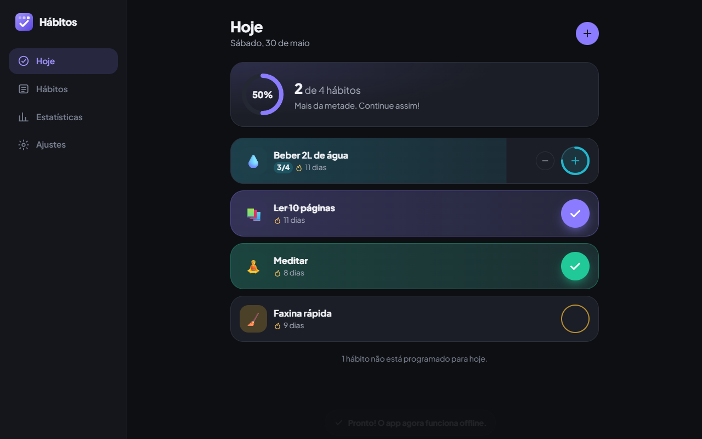

# Habits — habit tracker (PWA)

[🇧🇷 Português](README.md) · 🇺🇸 English

An installable, fully offline habit tracker built with React 19, TypeScript and Vite. Create daily habits or
habits for specific weekdays, set a daily target, check them off on the **Today** screen with satisfying
animations and follow your consistency with streaks (current and best), weekly stats and a GitHub-style
yearly heatmap. Data stays on your device, with JSON backups.

**Live demo:** https://portfolio.brunoisaac.dev/react-habit-tracker/



> Tip: on the first screen, tap **Try it with sample data** to explore months of history.

## Highlights

- **Habits CRUD:** name, emoji, color, frequency (every day or specific weekdays) and a daily target
  (e.g. drink water 4× a day). Archive/restore without losing history, delete with confirmation.
- **Today:** only what is scheduled for the day, animated check button, counter for targets above 1,
  progress ring and confetti when the day is complete.
- **Streaks** that respect the frequency: off-schedule days never break a streak, and neither does a pending
  today. Fully unit tested.
- **Accessible SVG heatmap** (per habit and overall): tooltips, keyboard navigation, roving tabindex.
- **Stats:** weekly breakdown, 7/30-day completion rates, perfect days and a per-habit ranking.
- **JSON backup** export/import with strict validation.
- **PWA:** manifest, maskable/Apple icons, precaching service worker, works offline under the
  `/react-habit-tracker/` scope where the app is published.
- **Portuguese (pt-BR) and English**, light/dark/system theme, mobile-first layout, reduced motion support.

## Stack

React 19.2 · TypeScript 6.0 (strict) · Vite 7.3 · Motion 12 · Zustand 5 (persist) · date-fns 4 · i18next 26 and
react-i18next 17 · vite-plugin-pwa 1.2 · Vitest 4 with Testing Library · ESLint 10 and Prettier 3 · GitHub
Actions (CI) · Cloudflare Workers static assets.

## Internationalization

- Language order: saved choice (`localStorage` key `habitos:lang`) › browser language (`pt*` → pt-BR,
  anything else → en) › pt-BR. Switch it with the flag buttons (inline SVG, an accessible radio group) in the header or in
  **Settings › Language**; `<html lang>` and
  the page title follow.
- One namespace per feature in `src/i18n/locales/<lang>/<namespace>.ts`. English files are typed against
  pt-BR and `t()` keys are typed through `CustomTypeOptions`, so missing keys fail the build.
- Translations are bundled modules, precached by the service worker, so both languages work offline.
- `useFormat()` formats dates (translated date-fns patterns), weekdays and ranges (`Intl.DateTimeFormat`) and
  percentages (`Intl.NumberFormat`). The domain layer has no copy: it returns codes that the UI translates.
- To add a language: copy `src/i18n/locales/en/`, translate it, register it in `src/i18n/resources.ts`, map
  its tag in `toSupportedLanguage`, add its date-fns locale in `useLocale.ts`, its native name and a flag in `Flag.tsx` and run `npm test` (a parity test
  checks that every language has the same keys).

## Running locally

```bash
npm install
npm run dev       # http://localhost:5173
npm test          # unit and component tests
npm run lint
npm run build     # production build with the /react-habit-tracker/ base
npm run build:cf  # same build, used by the Cloudflare deploy (output in dist/)
npm run preview   # http://localhost:4173/react-habit-tracker/
```

The full documentation (architecture decisions, folder structure, next steps) is in the
[Portuguese README](README.md).

## Deploy

Published on Cloudflare (Workers static assets) at https://portfolio.brunoisaac.dev/react-habit-tracker/ by the pipeline of the
[portfolio](https://github.com/BrunoICosta/portfolio) repository, which runs `npm run build:cf` and serves
`dist/` under `/react-habit-tracker/`. This repository only runs CI (lint, tests and build).

## Author

Bruno Vinicius Isaac Costa — https://github.com/BrunoICosta · [MIT License](LICENSE)
