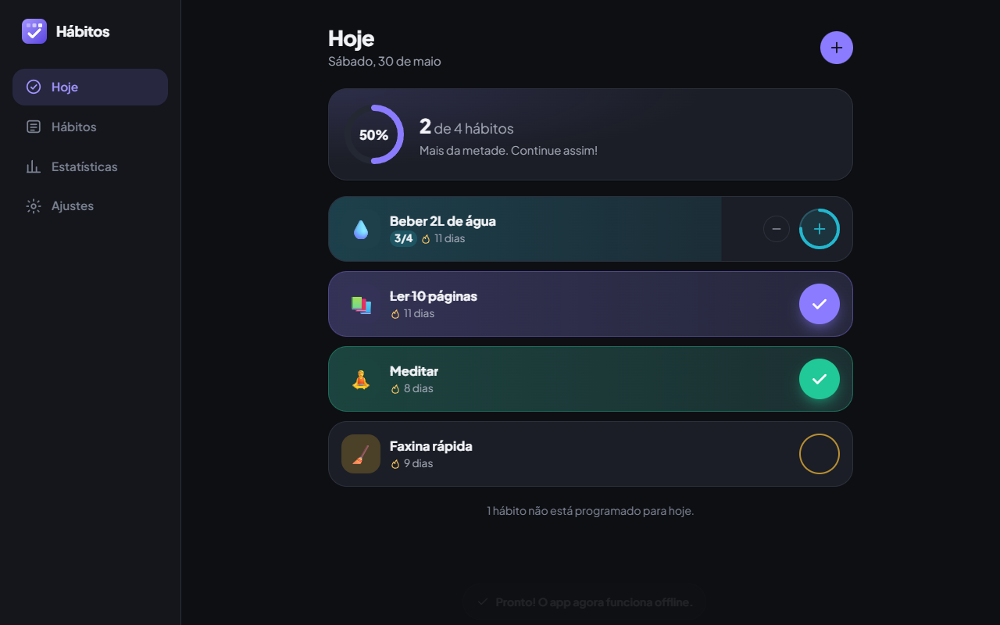

# Hábitos | rastreador de hábitos (PWA)

🇧🇷 Português · [🇺🇸 English](README.en.md)

Aplicativo de hábitos instalável e 100% offline, feito com React 19, TypeScript e Vite. Você cria hábitos
diários ou para dias específicos da semana, define uma meta por dia, marca o progresso na tela **Hoje** com
animações e acompanha sua consistência com sequências (atual e melhor), estatísticas semanais e um mapa de
calor anual no estilo do GitHub. Os dados ficam só no seu dispositivo, com backup em JSON.

**Demo:** https://portfolio.brunoisaac.dev/react-habit-tracker/



> Dica: na primeira tela, toque em **Ver com dados de exemplo** para explorar o app com meses de histórico.

## Funcionalidades

- **Hábitos (CRUD):** nome, ícone (emoji), cor, frequência (todos os dias ou dias específicos) e meta diária
  (ex.: beber água 4× por dia). Arquivar/restaurar sem perder histórico e excluir com confirmação.
- **Hoje:** lista apenas o que está programado para o dia, botão de check com animação (traço do ✓, pulso e
  partículas), contador para metas maiores que 1, anel de progresso e confete ao completar o dia.
- **Sequências:** sequência atual e melhor sequência respeitando a frequência, dias fora da agenda não
  quebram a sequência e o dia de hoje, ainda pendente, também não. Aviso quando a sequência está em risco.
- **Mapa de calor anual (SVG):** por hábito e geral, com tooltips, navegação por teclado (setas, Home/End,
  PageUp/PageDown), roving tabindex e rótulos acessíveis para leitores de tela.
- **Estatísticas:** taxa de conclusão da semana e dos últimos 30 dias, melhor sequência, dias perfeitos,
  gráfico da semana (com navegação entre semanas) e ranking por hábito.
- **Correção de dias passados:** na página do hábito, os últimos 7 dias podem ser marcados/desmarcados.
- **Backup:** exportar e importar JSON com validação completa do arquivo (nada de dados corrompidos no app).
- **PWA:** manifest, ícones (incluindo maskable e Apple), service worker com precache e funcionamento
  offline. `scope` e `start_url` respeitam o caminho `/react-habit-tracker/` onde o app é publicado.
- **Português (pt-BR) e inglês:** troca de idioma por bandeiras no cabeçalho e nos Ajustes, detecção automática do
  idioma do navegador, datas, dias da semana e porcentagens formatados no idioma ativo.
- **Tema claro/escuro/sistema**: sem flash na carga, e layout mobile-first que vira barra lateral no desktop.
- **Acessibilidade:** link "pular para o conteúdo", foco gerenciado na navegação, títulos por página,
  diálogos com focus trap e Esc, `prefers-reduced-motion` respeitado em CSS e nas animações.

## Stack

| Camada      | Tecnologia                                                        |
| ----------- | ----------------------------------------------------------------- |
| UI          | React 19.2, TypeScript 6.0 (strict + `noUncheckedIndexedAccess`)  |
| Build       | Vite 7.3, @vitejs/plugin-react 5.2                                |
| Animações   | Motion 12.38 (`motion/react`, sucessor do Framer Motion)          |
| Estado      | Zustand 5.0 com middleware `persist` (localStorage)               |
| Datas       | date-fns 4.1 (locales pt-BR e en-US) + `Intl`                     |
| i18n        | i18next 26, react-i18next 17, i18next-browser-languagedetector 8  |
| PWA         | vite-plugin-pwa 1.2 (Workbox), @vite-pwa/assets-generator 1.0     |
| Testes      | Vitest 4.1, Testing Library (React 16.3, user-event 14), jsdom 29 |
| Qualidade   | ESLint 10 + typescript-eslint, Prettier 3.8                       |
| Fonte       | Plus Jakarta Sans (Fontsource, empacotada para funcionar offline) |
| CI / Deploy | GitHub Actions (CI) + Cloudflare Workers static assets            |

## Arquitetura e decisões

- **Domínio puro em `src/core`.** Sequências, taxas, mapa de calor, validação de backup e dados de exemplo
  são funções puras, sem React, testadas isoladamente. A UI só chama essas funções.
- **Datas como `DateKey` (`yyyy-MM-dd`, horário local).** Evita bugs de fuso horário (um `Date` em UTC pode
  "virar" o dia) e serve de chave direta no histórico: `logs[habitId][dateKey] = quantidade`.
- **Regras de sequência explícitas:** só dias programados contam; um dia programado abaixo da meta quebra a
  sequência; hoje pendente não quebra; hábitos arquivados ficam congelados na data de arquivamento; histórico
  importado anterior à criação também é considerado.
- **Zustand + persist** em vez de Context/Redux: pouco boilerplate, seletores granulares (re-render só do que
  muda) e persistência pronta. `useShallow` para listas derivadas.
- **Roteador por hash próprio (~100 linhas).** Rotas em hash funcionam em qualquer hospedagem estática sem rewrites e
  offline no service worker; uma biblioteca de roteamento não traria ganho aqui.
- **Motion** para animações de layout, presença (entrada/saída de itens) e springs. O confete é gerado em
  handlers de evento (não em efeitos) para manter a renderização pura.
- **Mapa de calor em SVG manual**: sem biblioteca de gráficos: controle total de acessibilidade (grid ARIA,
  teclado, tooltips) e peso zero extra.
- **Sem backend e sem chaves de API:** privacidade por padrão; o backup JSON cobre a portabilidade.
- **CSS com design tokens** (custom properties) por tema e CSS colocalizado por componente, simples, rápido e
  sem runtime.

## Internacionalização

O app está em **português (pt-BR, padrão)** e **inglês (en)**, com i18next + react-i18next.

- **Detecção do idioma:** escolha salva (`localStorage`, chave `habitos:lang`) › idioma do navegador
  (`pt*` vira pt-BR, qualquer outro vira en) › pt-BR. A troca acontece pelas bandeiras no cabeçalho
  (🇧🇷/🇺🇸 desenhadas em SVG, num `radiogroup` acessível com setas do teclado) ou em **Ajustes › Idioma**, e atualiza `<html lang>` e o título da página.
- **Traduções por namespace** em `src/i18n/locales/<idioma>/<namespace>.ts` (`common`, `today`,
  `habits`, `stats`, `settings`, `heatmap`). Os arquivos em inglês são tipados com `typeof` do pt-BR, e
  `CustomTypeOptions` (`src/types/i18next.d.ts`) tipa as chaves de `t()`: chave faltando ou errada quebra o build.
- **Offline:** as traduções são módulos TypeScript empacotados no JS. O service worker faz precache delas
  junto com o app, então os dois idiomas funcionam offline sem rotas extras.
- **Formatação:** `useFormat()` (`src/i18n/useFormat.ts`) centraliza datas (padrões date-fns traduzidos e
  locale `ptBR`/`enUS`), dias da semana e intervalos (`Intl.DateTimeFormat`) e porcentagens
  (`Intl.NumberFormat`). O domínio (`src/core`) não tem textos: devolve códigos (padrão de frequência, erros
  de backup, mês `yyyy-MM`) que a UI traduz.
- **Plurais** usam os sufixos `_one`/`_other` do i18next (`Intl.PluralRules`).
- **Dados do usuário** (nomes dos hábitos) não são traduzidos. Os dados de exemplo são criados no idioma ativo.

**Como adicionar um idioma** (ex.: espanhol):

1. Crie `src/i18n/locales/es/` copiando os arquivos de `en/` e traduza os valores (o TypeScript aponta
   chaves faltando).
2. Registre o idioma em `src/i18n/resources.ts` (`SUPPORTED_LANGUAGES` e `resources`).
3. Ajuste `toSupportedLanguage` em `src/i18n/index.ts` para mapear `es*`, adicione o locale do date-fns
   em `src/i18n/useLocale.ts`, o nome nativo em `LANGUAGE_NATIVE_NAMES` (`resources.ts`) e a bandeira em
   `src/shared/components/Flag.tsx`.
4. Rode `npm test`: o teste de paridade confere se todos os idiomas têm as mesmas chaves.

## Como rodar

Pré-requisito: Node 22+.

```bash
npm install
npm run dev          # servidor de desenvolvimento em http://localhost:5173
npm test             # testes (Vitest, uma execução)
npm run test:watch   # testes em modo watch
npm run lint         # ESLint
npm run build        # type-check + build de produção (base /react-habit-tracker/)
npm run build:cf     # mesmo build, usado pelo deploy na Cloudflare (saída em dist/)
npm run preview      # serve o build em http://localhost:4173/react-habit-tracker/
```

O service worker só é registrado no build de produção (`npm run build && npm run preview`). Para regenerar
os ícones a partir de `public/favicon.svg`: `npm run generate-pwa-assets`.

## Estrutura de pastas

```
src/
├── app/            # shell: App, roteador por hash, barra de navegação, PWA e avisos
├── core/           # domínio puro + testes: datas, hábitos, sequências, estatísticas,
│                   # mapa de calor, backup e dados de exemplo
├── i18n/           # i18next, recursos pt-BR/en por namespace, useFormat e useLocale
├── features/
│   ├── today/      # tela Hoje (check-off animado, metas, celebração)
│   ├── habits/     # lista, formulário, detalhes do hábito
│   ├── heatmap/    # componente SVG acessível do mapa de calor
│   ├── stats/      # estatísticas e gráfico semanal
│   └── settings/   # tema, idioma e backup/importação
├── shared/         # componentes (ícones, diálogo, anel de progresso...), hooks e utilitários
├── store/          # stores Zustand (hábitos e preferências)
├── styles/         # tokens, base e primitivas de UI
├── types/          # tipos globais (CSS custom properties, i18next)
└── test/           # setup do Vitest
```

## Próximos passos

- Lembretes com notificações (Push API / Notification Triggers).
- Sincronização opcional entre dispositivos (ex.: arquivo no Google Drive ou backend próprio).
- Reordenar hábitos com arrastar e soltar.
- Hábitos com meta semanal ("3× por semana") além de dias fixos.
- Testes end-to-end com Playwright cobrindo instalação e uso offline.

## Deploy

Publicado na Cloudflare (Workers static assets) em https://portfolio.brunoisaac.dev/react-habit-tracker/ pelo pipeline do
repositório [portfolio](https://github.com/BrunoICosta/portfolio), que roda `npm run build:cf` e publica a
pasta `dist/` em `/react-habit-tracker/`. Este repositório só roda a CI (lint, testes e build).

## Autor

Bruno Vinicius Isaac Costa · https://github.com/BrunoICosta

## Licença

[MIT](LICENSE)
